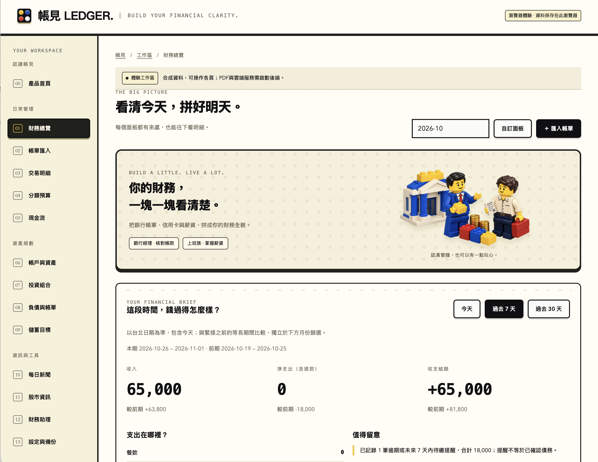
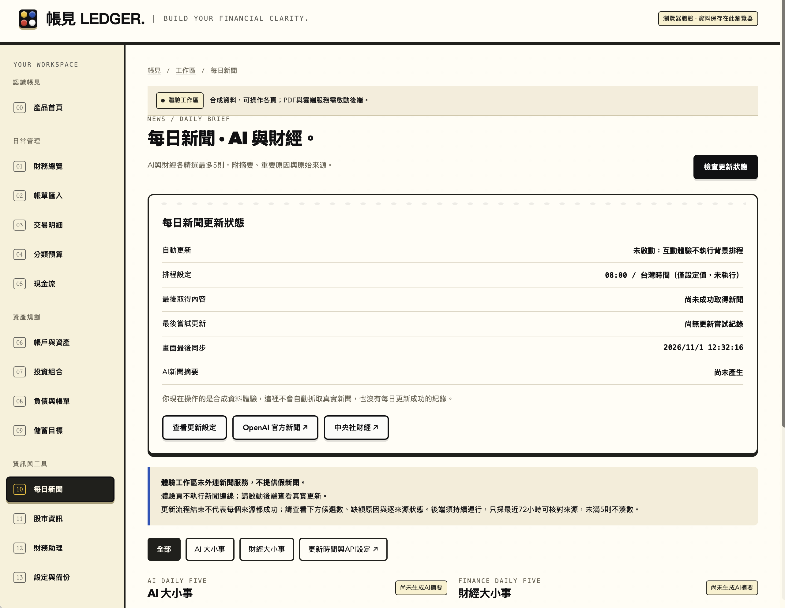
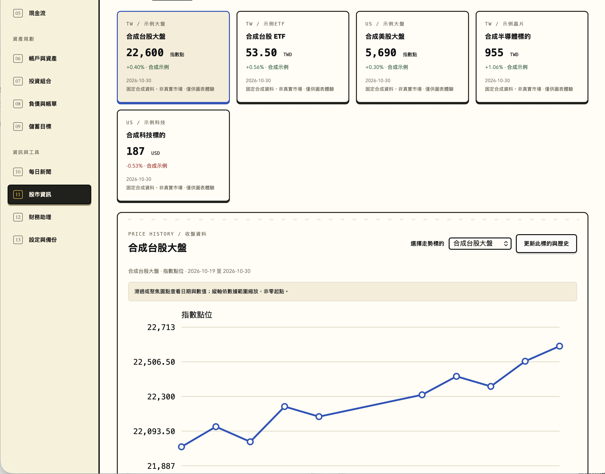

# 帳見 LEDGER｜AI 個人財務工作區

帳見是一個以文件匯入為入口的個人財務工作區。你可以把銀行對帳單、信用卡帳單、薪資 PDF 或交易 CSV 匯入本機帳本，先核對交易，再看收支、資產、預算與目標；需要時才啟用 AI 解讀、新聞與市場資料。不綁網銀，也不索取銀行密碼。

下面的介面截圖使用專案內建的**合成展示資料**，不含真實個人財務資料。完整專案可[下載 ZIP](zhangjian-ledger-source.zip)，也可在本儲存庫逐一瀏覽程式檔案。

## 實際介面







## 作品怎麼用

1. 匯入文字型 PDF 對帳單或標準 CSV，先人工核對，再寫入本機帳本。
2. 在儀表板看收支、分類、資產和負債，切換預算、現金流與儲蓄目標。
3. 需要時才啟用 AI 財務摘要；新聞和行情各顯示來源與資料日期。

**技術組成**：原生 HTML／CSS／JavaScript 前端、Python 標準函式庫本機 API、SQLite；PDF 文字抽取使用 Poppler。DeepSeek Chat Completions API 用於使用者同意後的財務解讀和新聞摘要；臺灣證券交易所公開 API 提供台股資料，Twelve Data API 提供部分美股／指數資料；新聞由白名單 RSS 來源擷取。服務金鑰由使用者自行設定，未放入儲存庫。

## 展示入口

- `dist/landing.html`：產品落地展示，有可切換圖表、功能導覽與使用流程。
- `dist/index.html`：完整14頁互動體驗，可直接開啟；使用明確標記的合成資料。
- 正式本機工作區：啟動後端後開啟 `http://127.0.0.1:8791/`。體驗資料與SQLite帳本分開。

## 已提供的功能

- 指定文字PDF版型／標準CSV上傳、人工覆核、精確去重、來源回查與交易修改。
- 可排序的總覽卡片、非負資產環形圖、含退款正負數的支出長條、月收支比較。
- 今天／過去7天／過去30天摘要、等長前期比較，以及按需AI財務解讀與改善建議。
- 預算、六個月現金流、手動資產／多幣別持倉、目標配置差額、XIRR、貸款攤還、應繳提醒與儲蓄目標。
- 獨立市場頁：台灣加權、道瓊、NASDAQ、S&P500、ETF與關注個股；有來源、日期、權限／缺資料狀態與歷史圖表。
- 每日新聞：AI與財經兩類，各最多5則，附摘要、來源與重要原因。來源不足不補造；每一來源的有效候選數、錯誤與缺額原因可見。

## 啟動

需求：Python3.10+、Node.js（重建與程式測試用）。文字PDF需要系統安裝Poppler的 `pdfinfo` 與 `pdftotext`；CSV不需要Poppler。Python後端使用標準函式庫，無額外pip套件。

```sh
python3 backend/app.py --open
```

macOS也可執行 `start.command`。服務只綁127.0.0.1；資料保存在 `data/ledger.sqlite3`，停止按Ctrl+C。更新後端程式後需重啟一次，再重新整理網頁。

## AI、新聞與行情設定

DeepSeek使用 `LEDGER_DEEPSEEK_API_KEY`，模型可用 `LEDGER_DEEPSEEK_MODEL` 設定；預設 `deepseek-flash`。美股、ETF及部分指數使用另外的 `LEDGER_TWELVE_DATA_API_KEY`，資料範圍與延遲依方案及交易所權限。兩者不能混用。

可在工作區設定頁輸入；頁面設定的Key只保留後端執行期間，不進SQLite、備份或瀏覽器儲存。啟動也可使用環境變數或私人 `.ledger-secrets.json`（環境變數優先）。`.env.example` 只提供欄位參考，後端不會自動讀取.env；公開倉庫不含任何真實Key。

財務AI只有按明確同意按鈕才傳送期間彙總與問題，不附原始PDF／帳號／商家交易清單，也不具下單、轉帳或修改帳本權限。改善建議依資料說明發現、依據、行動與適用時機，不固定要求下週減支，也不在資料不足時硬湊答案。

新聞預設每日08:00（Asia/Taipei），可更改或關閉，**後端需持續運行**。頁面進入即讀快取，停留時每60秒同步、工作執行中每2.5秒同步；讀快取不會再次呼叫模型，只有排程或明按更新才抓來源及摘要。GoogleAI與中央社採官方目前RSS入口，另有BBC／Guardian財經來源。抓取失敗保留舊內容與原日期，不顯示成今天更新。

台股採TWSE公開日收盤資料；市場不是交易介面。報價與個人持倉盈虧分開，行情不直接覆寫手動持倉。每次最多6筆美股請求、更新冷卻60秒；可選單標的載入真歷史，不補造缺失日期。

## 驗證與範圍

```sh
python3 build_web.py --no-preview
python3 backend/verify_core.py
python3 backend/verify_live.py
```

核心測試含真Poppler、臨時SQLite、dispatcher與NodeVM；雲端／行情合約測試使用明示的假資料，不等同真瀏覽器或真API驗收。`verify_live.py` 使用隔離合成帳本，實際呼叫AI、雙類新聞與行情，會使用API額度；缺Key、來源不足或連線失敗不判通過。完整原企劃交付另由 `backend/release_gate.py` 檢查，未測項不補分。

目前為可測試的作品版本。任意銀行版型、掃描／圖片OCR、ZIP匯入、資料庫加密、生物辨識、完整JSON還原、iPhone自動通知記帳尚未完成。資料庫未加密；原始PDF不留存，解析欄位與稽核紀錄留在本機。正式公開服務仍需部署、驗證、存取控制與完整瀏覽器驗收，不能把這個本機作品當成已上線金融服務。

## 原始碼

`backend/` 本機API與計算；`dist/` 工作區、圖表、互動展示與落地頁；`fixtures/` 合成文件；`qa/tests/` 回歸測試。公開版本排除帳本、私密設定、工作記錄、內部測試報告與個人文件。

介面以Covera配色為參考，搭配原創積木人物插畫，不代表LEGO或任何金融機構官方授權。

## GitHub Pages 靜態展示

倉庫完成授權與推送後，可在GitHub的Pages設定選GitHub Actions，再手動執行 `Publish static demo` 工作流程。它只發布dist的合成互動體驗；落地介紹位於 `/landing.html`。Python後端、真帳本與任何Key不會部署到Pages。工作流程尚未執行前，不代表已取得公開展示網址。
